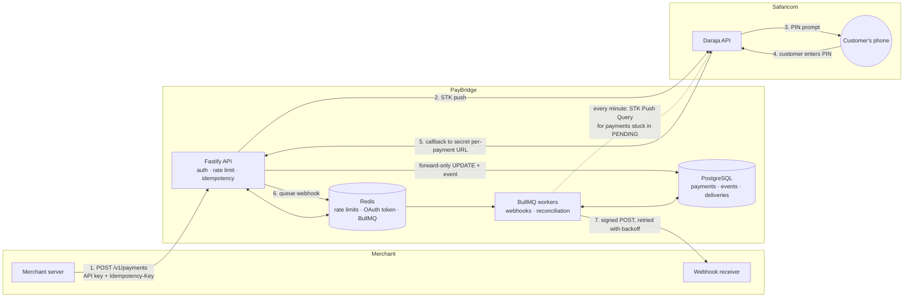

# PayBridge

[](https://github.com/iochieng1/paybridge/actions/workflows/ci.yml)

**An M-Pesa payments gateway API that is rate-limited, idempotent, and can't double-credit a payment.**

<!-- TODO(#9): demo GIF here: create a payment, STK prompt on the phone, webhook arrives -->

> **Live API:** _deploying soon_ · **Docs:** `/docs` (Swagger UI) · `/openapi.json`

PayBridge lets any app accept M-Pesa payments through one clean REST API. It deals with the messy parts of Safaricom's Daraja API: STK push timeouts, duplicate callbacks, unsigned webhooks and token expiry. You don't have to.

The public demo runs against the **Daraja sandbox**. No real money moves.

## Features

- [x] Fastify + TypeScript service with validated config and graceful shutdown
- [x] PostgreSQL schema and migrations for merchants, tokens, API keys, payments, audit log, idempotency and webhooks
- [x] `/health` endpoint that checks Postgres and Redis
- [x] CI: lint, format, typecheck, migration drift check, integration tests on real Postgres/Redis, secret scanning
- [x] Merchant registration and login (argon2id passwords, 15-minute access JWT)
- [x] Refresh-token rotation and reuse detection
- [x] Redis sliding-window rate limiter (atomic Lua script)
- [x] API keys and OpenAPI/Swagger docs
- [x] Typed Daraja client: OAuth token cached in Redis, STK push, STK Push Query
- [x] STK push payments with `Idempotency-Key` support
- [x] Callback handling with deduplication and a forward-only state machine
- [x] Reconciliation job for lost callbacks (STK Push Query)
- [x] HMAC-signed merchant webhooks with exponential-backoff retries

## Architecture



1. The merchant's server creates a payment with its API key and an `Idempotency-Key`. A retry with the same key replays the first response and never sends a second push.
2. PayBridge sends an STK push to Daraja with a callback URL that contains a 256-bit token for this payment.
3. Daraja shows the customer a PIN prompt for the amount.
4. The customer enters their PIN, cancels or ignores it.
5. Daraja posts the result to the callback URL. PayBridge checks it, confirming with STK Push Query if anything looks wrong, and settles the payment with a conditional `UPDATE`, so duplicates and late callbacks change nothing.
6. The final status queues a webhook job (one per payment).
7. A worker POSTs it to the merchant, signed with HMAC-SHA256, and retries for about 15 hours if it fails.

If step 5 never happens, the every-minute reconciliation job asks Daraja about the payment and settles it the same way.

## Quick start

Requires Node 24 (`nvm use`) and Docker.

```bash
npm install
cp .env.example .env
docker compose up -d     # Postgres + Redis
npm run db:migrate
npm run dev              # http://localhost:3000/health
```

Then open http://localhost:3000/docs for the interactive API reference.

## Authentication

There are two kinds of credentials:

| Who                | Credential                                                       | Used for                                |
| ------------------ | ---------------------------------------------------------------- | --------------------------------------- |
| A merchant (human) | Access token from `POST /v1/auth/login` (15 min) + refresh token | Dashboard routes such as `/v1/api-keys` |
| A merchant server  | API key `pb_test_<prefix>_<secret>` from `POST /v1/api-keys`     | Payment routes                          |

Both are sent as `Authorization: Bearer <token>`.

```bash
# Create an API key (the full key is shown once; store it somewhere safe)
curl -X POST http://localhost:3000/v1/api-keys -H "Authorization: Bearer $ACCESS_TOKEN"

# List keys (prefixes only) and revoke one
curl http://localhost:3000/v1/api-keys -H "Authorization: Bearer $ACCESS_TOKEN"
curl -X DELETE http://localhost:3000/v1/api-keys/$KEY_ID -H "Authorization: Bearer $ACCESS_TOKEN"
```

## Scripts

| Command                              | What it does                                                   |
| ------------------------------------ | -------------------------------------------------------------- |
| `npm run dev`                        | Start the API with hot reload                                  |
| `npm test`                           | Integration tests (starts throwaway Postgres/Redis containers) |
| `npm run lint` / `npm run typecheck` | Static checks                                                  |
| `npm run db:generate`                | Generate a SQL migration after editing `src/db/schema.ts`      |
| `npm run db:migrate`                 | Apply migrations to `DATABASE_URL`                             |
| `npm run mpesa:smoke -- <phone>`     | Manual Daraja sandbox smoke test (see below)                   |
| `k6 run load/rate-limit.js`          | Load test the rate limiter (see Load testing)                  |
| `npm run build && npm start`         | Production build; `start` applies migrations, then boots       |

## Payments

A merchant server creates a payment with its API key. The `Idempotency-Key` header is required:

```bash
curl -X POST http://localhost:3000/v1/payments \
  -H "Authorization: Bearer $API_KEY" \
  -H "Idempotency-Key: order-1001-attempt-1" \
  -H "Content-Type: application/json" \
  -d '{"phone": "0712345678", "amount": 1500, "reference": "INV-1001", "description": "Order 1001"}'
```

- `202` with `status: "PENDING"`: the customer has the STK prompt; the result arrives by callback.
- `502` with `status: "FAILED"` and `result_desc`: M-Pesa rejected the push.
- Retrying with the same key and body returns the first response with `Idempotent-Replayed: true`, and never sends a second push. The same key with a different body gets `422`; a retry while the first request is still running gets `409` with `Retry-After: 1`. Keys are kept for 24 hours.
- `GET /v1/payments/:id` returns one payment; `GET /v1/payments?status=SUCCEEDED&created_from=…&created_to=…&limit=20&cursor=…` lists them newest first. A merchant only ever sees its own payments.
- Amounts are whole shillings from 1 to 250,000. Every status change is appended to `payment_events`.

## Callbacks

Daraja reports each STK push result by POSTing to the payment's callback URL, `/v1/callbacks/mpesa/:token`.

| `ResultCode`  | Payment status                       |
| ------------- | ------------------------------------ |
| `0`           | `SUCCEEDED` (with `mpesa_receipt`)   |
| `1032`        | `CANCELLED` (customer dismissed it)  |
| `1037`        | `TIMED_OUT` (customer didn't answer) |
| anything else | `FAILED`                             |

**The state machine only moves forward.** The update is `UPDATE … WHERE id = ? AND status IN ('CREATED', 'PENDING')`, in one transaction with its `payment_events` row. Once a payment is final, nothing changes it: a duplicate, a replay or a late "failed" after a success updates no row, records no event and still gets `200` so Daraja stops sending it. Concurrent copies of one callback race on the row lock, and exactly one wins. `mpesa_receipt` is unique across all payments.

### Why three checks, when callbacks aren't signed

Daraja doesn't sign callbacks, so anyone who can reach the endpoint could post a fake "paid". Each of these checks covers a gap the others leave:

1. **A secret token per payment.** Each callback URL carries 256 random bits, generated for that payment and sent only to Daraja. Only its SHA-256 hash is stored, so a database leak doesn't reveal working URLs. An unknown token gets `404`. A guessable URL, such as one built from the payment id, would let anyone settle any payment. With a token, a forger would have to see the URL first.
2. **An optional IP allowlist** (`MPESA_CALLBACK_IP_ALLOWLIST`, comma-separated). Callbacks from anywhere else get `403`, so even a leaked token (in a proxy log, say) is useless from outside Safaricom's network. It's optional because Safaricom's IPs can change and differ per environment, and a wrong list silently drops real payments. Behind a proxy it needs `TRUST_PROXY=true` to see the real client IP.
3. **STK Push Query for anything unexpected.** If the callback's `CheckoutRequestID` isn't the payment's, a success has no receipt, the `Amount` differs from the payment, or the receipt already belongs to another payment, the callback isn't trusted. PayBridge asks Daraja directly (an authenticated call it initiates) and applies only the query's result. The callback's receipt is never stored in that case, because nothing vouches for it. If the query says the payment is still processing, nothing changes (reconciliation will catch up). If Daraja can't be reached, the callback gets `503` so it can be redelivered.

The token stops outsiders, the allowlist limits the damage if a token leaks, and the query means that even a callback which passes both can't settle a payment with the wrong amount or a fake receipt.

## Reconciliation

Sometimes Daraja's callback never arrives: the customer paid, but PayBridge wasn't told. A BullMQ repeatable job runs every minute and finds `PENDING` payments that haven't changed for 2 minutes. For each one it asks Daraja with STK Push Query and applies the answer through the same forward-only transition as a callback (`payment_events` records it as `reconciled`).

- If Daraja says the payment is still processing, it stays `PENDING` and goes to the back of the queue. At most 50 payments are checked per run.
- A callback and reconciliation can race, and the job can run on two instances or run again after a crash. The conditional `UPDATE … WHERE status IN ('CREATED', 'PENDING')` lets exactly one of them settle the payment.
- A payment whose STK push outcome was unknown has no `CheckoutRequestID`, so it can't be queried. It waits for its callback rather than being marked failed, because the customer may have paid.
- The job is registered with `upsertJobScheduler`, so every instance can register it on start-up and it still runs once a minute in total.

## Webhooks

When a payment reaches a final status, PayBridge POSTs it to the merchant's endpoint. Set the endpoint with an access token; the signing secret is shown **once**:

```bash
curl -X PUT http://localhost:3000/v1/webhook-endpoint \
  -H "Authorization: Bearer $ACCESS_TOKEN" \
  -H "Content-Type: application/json" \
  -d '{"url": "https://duka.co.ke/webhooks/paybridge"}'
# {"url": "https://duka.co.ke/webhooks/paybridge", "secret": "whsec_…"}
```

Calling it again replaces the URL and the secret. `GET` shows the URL and `DELETE` removes it.

Each webhook looks like this:

```http
POST /webhooks/paybridge
Content-Type: application/json
X-PayBridge-Signature: t=1794000000,v1=<64 hex characters>
X-PayBridge-Event-Id: evt_5f0c2a8e-1b7d-4c3e-9f6a-2d8b4e1c7a90

{"id":"evt_5f0c2a8e-…","type":"payment.succeeded","created_at":"2026-11-13T09:31:02.000Z","data":{"id":"5f0c2a8e-…","status":"SUCCEEDED","amount":1500,"mpesa_receipt":"TKB4XYZ123",…}}
```

`type` is `payment.succeeded`, `payment.failed`, `payment.cancelled` or `payment.timed_out`, and `data` is the same object `GET /v1/payments/:id` returns.

- **Retries.** Any response other than `2xx`, a timeout (10 seconds) or a connection error is retried after 1 minute, 5 minutes, 30 minutes, 2 hours and 12 hours: six attempts over about 15 hours. A `2xx` stops it.
- **Every attempt is logged** in `webhook_deliveries` with its status code or error and when the next retry is due. Merchants can see them at `GET /v1/payments/:id/webhook-deliveries`.
- **At least once.** If PayBridge crashes after your server answered `2xx` but before it recorded that, the webhook can arrive twice. The event `id` is the same both times (one per payment), so ignore an `id` you've already processed.
- **Redirects aren't followed**, and in production URLs must be `https` and resolve to public addresses (see Trade-offs).

### Verifying the signature

The signature is `HMAC-SHA256(secret, "<t>.<raw body>")` in hex. Check it against the **raw** request body (re-serialised JSON won't match), compare in constant time, and reject old timestamps so a captured request can't be replayed:

```js
import { createHmac, timingSafeEqual } from "node:crypto";

const TOLERANCE_SECONDS = 300;

export function verifySignature(secret, header, rawBody) {
  const parts = Object.fromEntries(
    (header ?? "").split(",").map((part) => part.trim().split("=", 2)),
  );
  const timestamp = Number(parts.t);
  if (!Number.isInteger(timestamp) || !/^[0-9a-f]{64}$/.test(parts.v1 ?? "")) {
    return false;
  }

  const expected = createHmac("sha256", secret)
    .update(`${timestamp}.${rawBody}`)
    .digest();
  if (!timingSafeEqual(expected, Buffer.from(parts.v1, "hex"))) return false;

  return Math.abs(Date.now() / 1000 - timestamp) <= TOLERANCE_SECONDS;
}

// Express: app.post("/webhooks/paybridge", express.raw({ type: "application/json" }), (req, res) => {
//   if (!verifySignature(process.env.PAYBRIDGE_WEBHOOK_SECRET, req.get("X-PayBridge-Signature"), req.body.toString("utf8"))) {
//     return res.sendStatus(400);
//   }
//   const event = JSON.parse(req.body);
//   // ...mark the order paid if you haven't seen event.id before...
//   res.sendStatus(200);
// });
```

Answer `2xx` quickly and do slow work afterwards; anything that takes over 10 seconds counts as a failure and is retried.

## Project structure

```
src/
  app.ts            # Fastify app factory (used by server and tests)
  server.ts         # Entry point: listen + graceful shutdown
  config.ts         # zod-validated environment variables
  db/
    schema.ts       # Drizzle schema (source of truth)
    client.ts       # Postgres connection
    migrate.ts      # Migration runner
  openapi.ts        # OpenAPI document (/openapi.json) and Swagger UI (/docs)
  auth/             # Passwords, access/refresh tokens, API keys
  mpesa/            # Daraja client (OAuth, STK push, STK query), phone normalisation
  payments/         # Payment creation, state transitions, idempotency keys, reconciliation
  webhooks/         # Signing, secret encryption, SSRF-safe delivery
  jobs/             # BullMQ queues and workers (webhooks, every-minute maintenance)
  rate-limit/       # Sliding-window limiter (Lua) and the configured limits
  routes/           # HTTP routes with zod request/response schemas
drizzle/            # Generated SQL migrations (committed)
test/               # Vitest + Testcontainers integration tests
```

## Trade-offs

Decisions and the reasons for them. This section grows as features land.

- **PostgreSQL over MongoDB.** Payments need ACID transactions, unique constraints (`checkout_request_id`, `mpesa_receipt`) for deduplication, and conditional updates for the state machine.
- **Amounts as integers.** Daraja accepts only whole shillings, so there is no floating-point money anywhere.
- **Tests run against real Postgres and Redis (Testcontainers), not mocks.** The guarantees this service makes come from database constraints, row locks and Redis Lua scripts. Mocks would test none of them.
- **Migrations run on start-up.** On a single-instance free-tier deploy, this guarantees the schema matches the code. With multiple instances it would move to a separate release step.
- **argon2id for passwords.** It is memory-hard, which makes GPU cracking expensive. Parameters follow OWASP (19 MiB, 2 iterations, 1 lane).
- **Login doesn't reveal which emails exist.** A wrong email and a wrong password get the same `401` and message. For an unknown email, login still runs a full argon2 verification against a dummy hash, so response times match too.
- **Short-lived stateless access tokens.** Access JWTs (HS256) last 15 minutes and aren't stored, so verifying one needs no database lookup for the token itself. Revocation comes from refresh-token rotation: once a session is revoked, its access token stops working within 15 minutes.
- **Refresh tokens rotate on every use.** Login returns a 7-day refresh token. `POST /v1/auth/refresh` marks it used and returns a new access and refresh pair in the same _family_ (one family per login). Each refresh token works once. Logging out with `POST /v1/auth/logout` revokes the family and leaves the merchant's other sessions alone.
- **Reuse means theft, so the whole family is revoked.** A used token should never come back. If one does, someone has a copy, and we can't tell whether it's the attacker or the real client. Revoking every token in the family, including the newest, logs out both, so the real user has to log in again and the attacker is locked out. All failures (unknown, expired, revoked, reused) get the same `401`, so the response doesn't reveal why.
- **No grace period for concurrent refreshes.** Two requests with the same token are serialised by a per-family Postgres advisory lock. The first one rotates; the second looks like reuse and revokes the family. A buggy client that refreshes twice in parallel gets logged out, but an attacker can't slip in during a grace window. The lock also makes sure a revocation can't miss a token that is being inserted at the same moment.
- **Refresh tokens are random and stored as SHA-256 hashes.** They carry 256 bits of entropy, so a fast hash is enough (argon2 is for low-entropy passwords). A database leak doesn't give anyone usable tokens.
- **Email uniqueness is enforced by the database.** `merchants_email_lower_idx` is a unique index on `lower(email)`. Registration relies on it instead of checking first, so two concurrent sign-ups can't both succeed.
- **Rate limiting uses a sliding-window log in Redis.** Each key is a sorted set of request timestamps. One Lua script removes entries older than the window, counts the rest and adds the new request only if it fits, so the check is atomic and concurrent requests can't overshoot. Limits: login 5/min per IP + email, payments 60/min per API key, everything 300/min per IP. Responses carry `RateLimit-Limit` and `RateLimit-Remaining`, plus `Retry-After` on `429`.
  - _Fixed window_ (one counter per minute) is cheaper, but a client can send the full limit at 0:59 and again at 1:00: twice the limit in two seconds.
  - _Sliding-window counter_ (weighting the previous window's count) is O(1) memory, but it's an estimate that assumes requests were spread evenly, so it can let a burst through or block a client too early.
  - _Sliding-window log_ is exact. It stores one entry per request, but the limits here are small (at most 300 per key), so memory is bounded and cheap. Rejected requests aren't recorded, so a client that keeps retrying still gets back in once old entries age out.
- **Fail-open for payments, fail-closed for login.** If Redis is down, the payments limiter lets requests through, because an outage shouldn't stop merchants taking money, and idempotency keys still stop duplicate charges. The login limiter returns `503`, because without it passwords could be guessed at full speed. Both log a warning.
- **`TRUST_PROXY` is off by default.** Per-IP limits need the real client IP. Behind Render's proxy that comes from `X-Forwarded-For`, so `render.yaml` turns it on. Anywhere else, trusting that header would let clients choose their own IP and dodge the limits.
- **API keys are shown once and stored as a prefix plus a hash.** A key is `pb_test_<prefix>_<secret>`. The 12-hex-character prefix is stored in plaintext so the key can be found with one indexed lookup and shown in `GET /v1/api-keys`. The secret is 256 random bits and only its SHA-256 hash is stored (compared in constant time), so neither a database leak nor the logs (the `Authorization` header is redacted) give anyone a working key. Like refresh tokens, the secret is high-entropy, so a fast hash is enough.
- **Unknown, revoked and wrong-secret API keys get the same `401`.** Revoking sets `revoked_at` and takes effect on the next request; there is no cache to wait out. Every successful request updates `last_used_at`, so merchants can spot keys that are unused and safe to revoke.
- **Separate credentials for people and servers.** Access tokens (short-lived, from a password login) manage the account, including creating keys. API keys (long-lived, revocable, one per server) take payments. A leaked API key can't create more keys or change the account, and access tokens aren't accepted on payment routes or vice versa.
- **The Daraja OAuth token lives in Redis, not in process memory.** Every instance shares one token, so a deploy or restart doesn't fetch a new one, and Daraja's token endpoint isn't hit once per process. It is refreshed a minute early so a request never goes out with a token that expires in flight. The cache key holds a hash of the consumer key, never the key itself.
- **Daraja calls aren't retried, apart from one retry after a rejected token.** Retrying an STK push after a timeout could prompt the customer twice. Whether a push went through is answered later by the callback or STK Push Query, not by guessing.
- **Idempotency keys are claimed with `INSERT … ON CONFLICT DO NOTHING`.** The primary key is `(merchant_id, key)`, so of any number of concurrent requests with the same key, Postgres lets exactly one insert through. Only that one sends the STK push; the rest get `409` while it runs and a replay of its stored response afterwards. Checking first and inserting after would let two requests both see "no key" and both charge the customer. The key also stores a SHA-256 of the request (phone normalised, field order ignored), so reusing a key for a different payment is caught (`422`) instead of silently returning the wrong payment.
- **`409` while in progress, rather than waiting.** Holding the duplicate request open until the first finishes would tie up a connection for as long as Daraja takes. A `409` with `Retry-After` is cheap, and the retry gets the stored response.
- **A key stays claimed if the push may have been sent.** If anything fails after Daraja was called, the key is not released: a retry with the same key gets `409` until the key expires. That's annoying but recoverable (use a new key after checking the payment); releasing it could charge the customer twice. Failures before the call release the key so the client can simply retry.
- **An unclear STK push result is left `PENDING`, not marked failed.** A timeout, network error or 5xx without an error code doesn't say whether the customer was prompted. Marking it `FAILED` would be wrong if they then pay, so the payment stays `PENDING` and the callback (found by its token, which doesn't need a checkout id) or reconciliation settles it. Only a definite rejection (a Daraja error code or a 4xx) is `FAILED`.
- **Expired keys are purged hourly and ignored on lookup.** A key older than 24 hours is deleted before it's claimed again, so expiry is exact even between purges; the hourly job only keeps the table small.
- **Cursor pagination over `(created_at, id)`.** Offsets get slow and skip or repeat rows when new payments arrive between pages; a keyset cursor doesn't. The cursor holds `created_at` as Postgres prints it, to the microsecond, because a JS `Date` keeps only milliseconds and would lose rows created within the same millisecond.
- **Fastify over Express.** It has schema-based validation and serialisation built in, and OpenAPI generation comes from the same schemas.
- **zod schemas are the single source of truth for each route.** The same schema validates the request, types the handler, filters the response (unknown fields are never serialised, so a column like `key_hash` can't leak by accident) and generates the OpenAPI document served at `/openapi.json` and `/docs`. Every route documents its request, its responses and an example payload, and a test fails if one doesn't or if the document stops being valid OpenAPI 3.1.
- **BullMQ on the Redis we already run, not a new piece of infrastructure.** Delayed jobs, retries with custom backoff, repeatable jobs and stalled-job recovery come built in. A Postgres-only queue (`SELECT … FOR UPDATE SKIP LOCKED`) would also work and would make queueing transactional, but it means writing the scheduling and backoff by hand.
- **Workers run inside the API process.** On a single free-tier instance there's nowhere else to run them. `RUN_WORKERS=false` turns them off, so a separate worker service could take over without code changes.
- **Webhooks are queued after the payment's transaction commits, and a sweep covers the gap.** If the process dies between the commit and the queue, the every-minute job finds final payments from the last hour that have no delivery logged and queues them. The job id is derived from the payment (`payment-<id>`), so queueing twice is a no-op and a merchant gets one webhook per payment, not one per path that noticed it.
- **Delivery is at least once, not exactly once.** Exactly once isn't possible over HTTP: if the merchant's `2xx` is lost, PayBridge can't know it was processed. Before sending, a job checks whether a delivery was already logged, which closes most of the gap after a crash; a stable event `id` lets merchants close the rest.
- **The timestamp is inside the signature.** Signing `t.body`, not just the body, means a captured webhook can't be replayed later with a fresh timestamp, and receivers can reject anything older than five minutes. Verification checks the HMAC before the timestamp and compares in constant time.
- **Signing secrets are encrypted, not hashed.** PayBridge has to read the secret to sign each payload, so a hash won't do. It's encrypted with AES-256-GCM using a key derived (HKDF) from `WEBHOOK_ENCRYPTION_KEY`, which lives only in the environment. A database dump alone doesn't reveal any secret, and GCM's authentication tag means a tampered row fails to decrypt instead of producing a wrong secret.
- **Webhook URLs can't reach private networks (SSRF).** Otherwise a merchant could set `http://169.254.169.254/` or an internal service as its URL and have PayBridge call it. The URL is checked when it's set, but the real check is in the socket's DNS lookup at delivery time: every resolved address must be public, so a hostname can't pass the check and then resolve to `10.0.0.5` for the connection (DNS rebinding). Redirects aren't followed for the same reason. `WEBHOOK_ALLOW_PRIVATE_URLS=true` lifts this for local development.
- **Any non-`2xx` is retried, including `4xx`.** A `404` or `401` from a merchant is usually a deploy or config mistake that gets fixed within the retry window. Six attempts over about 15 hours is a bounded cost for that.
- **Reconciliation waits 2 minutes and doesn't query unclear pushes.** The STK prompt times out on the phone after about a minute, so by 2 minutes Daraja has a final answer and the callback has normally arrived; waiting less would mostly duplicate callbacks. A payment with no `CheckoutRequestID` can't be queried, and marking it failed could be wrong, so it waits for its callback.

## M-Pesa (Daraja)

`src/mpesa/daraja.ts` is a typed client for Safaricom's Daraja API. It is configured only through environment variables (see `.env.example`):

| Variable                                       | Notes                                                                   |
| ---------------------------------------------- | ----------------------------------------------------------------------- |
| `MPESA_CONSUMER_KEY` / `MPESA_CONSUMER_SECRET` | From your app on the [Daraja portal](https://developer.safaricom.co.ke) |
| `MPESA_SHORTCODE`                              | Paybill/till number; the shared sandbox one is `174379` (default)       |
| `MPESA_PASSKEY`                                | Lipa na M-Pesa Online passkey for the shortcode                         |
| `MPESA_ENV`                                    | `sandbox` (default) or `production`                                     |
| `PUBLIC_BASE_URL`                              | Public HTTPS origin Daraja sends STK callbacks to                       |
| `MPESA_CALLBACK_IP_ALLOWLIST`                  | Optional comma-separated IPs allowed to post callbacks (empty = any)    |

- **OAuth:** the access token is cached in Redis, shared by every instance, and refreshed 60 seconds before Daraja's roughly one-hour expiry. Concurrent callers in one process share a single fetch. If Daraja rejects a cached token anyway, the client fetches a new one and retries once. If Redis is down, it fetches a token per request instead of failing.
- **STK push:** `password = base64(shortcode + passkey + timestamp)`, with the timestamp as `YYYYMMDDHHmmss` in Africa/Nairobi time. Phone numbers in any common format (`0712 345 678`, `+254712345678`, `0110…`) are normalised to `2547XXXXXXXX` / `2541XXXXXXXX`; anything else is rejected before calling Daraja.
- **STK Push Query** returns `{ status: "completed", resultCode, ... }` or `{ status: "pending" }` while the customer hasn't responded. Reconciliation will use it for lost callbacks.
- Every call has a 10-second timeout, and failures throw a `DarajaError` carrying the HTTP status and Daraja's `errorCode`.

Tests run the client against a fake Daraja HTTP server on localhost, so CI never touches the network.

### Sandbox smoke test (manual)

Run this after changing the client to check it against the real sandbox. It needs a Safaricom number with the M-Pesa app or SIM toolkit; the sandbox doesn't move real money.

1. Create an app on the [Daraja portal](https://developer.safaricom.co.ke) with **M-Pesa Sandbox** enabled. Put its Consumer Key and Secret in `.env` as `MPESA_CONSUMER_KEY` / `MPESA_CONSUMER_SECRET`, and the sandbox passkey (APIs → M-Pesa Express → Simulate) as `MPESA_PASSKEY`. Keep `MPESA_SHORTCODE=174379` and `MPESA_ENV=sandbox`.
2. Set `PUBLIC_BASE_URL` to any HTTPS URL. The smoke test reads the result with STK Push Query, so the callback doesn't have to be reachable; use a tunnel (`ngrok http 3000`) if you want to see it arrive.
3. Start Redis (`docker compose up -d`) and run:

   ```bash
   npm run mpesa:smoke -- 0712345678      # optional second argument: amount (default 1)
   ```

4. Expect `OAuth token: ok`, then `STK push accepted` with a `checkoutRequestId`, and a payment prompt on the phone. Enter the PIN or cancel; within a few polls the script prints `status: "completed"` with `resultCode: 0` (paid) or `1032` (cancelled). Running it again within the hour reuses the cached token.

## Load testing

`load/rate-limit.js` is a [k6](https://k6.io) script that sends 240 payment requests a minute on one API key against a limit of 60, with steady `/health` traffic alongside. It fails if more than 60 payments get through in the minute, if any request gets a `5xx`, or if p95 latency goes over 200 ms.

```bash
BASE_URL=https://<your-service>.onrender.com API_KEY=pb_test_... k6 run load/rate-limit.js
```

<!-- TODO(#9): paste the k6 summary from a run against the deployed service here. -->

## Deployment

`render.yaml` is a Render Blueprint that creates the web service (Docker), PostgreSQL and Key Value (Redis):

1. In Render, choose **New → Blueprint** and connect this repository.
2. When prompted, fill in the variables marked `sync: false`: the Daraja **sandbox** `MPESA_CONSUMER_KEY`, `MPESA_CONSUMER_SECRET` and `MPESA_PASSKEY`, and `PUBLIC_BASE_URL` (the service's `https://….onrender.com` URL, which Render shows once the service exists; set it and redeploy). `JWT_SECRET` and `WEBHOOK_ENCRYPTION_KEY` are generated for you.
3. Deploy. Migrations run on start-up, and `/health` turns green once Postgres and Redis are reachable.
4. Open `/docs` on the service URL, register a merchant, log in, create an API key, and create a payment to your own Safaricom number.

The free web service sleeps when idle, so the first request after a while takes about 30 seconds while it wakes up. The reconciliation job and webhook retries pause while it sleeps and catch up when it wakes.

## License

MIT
